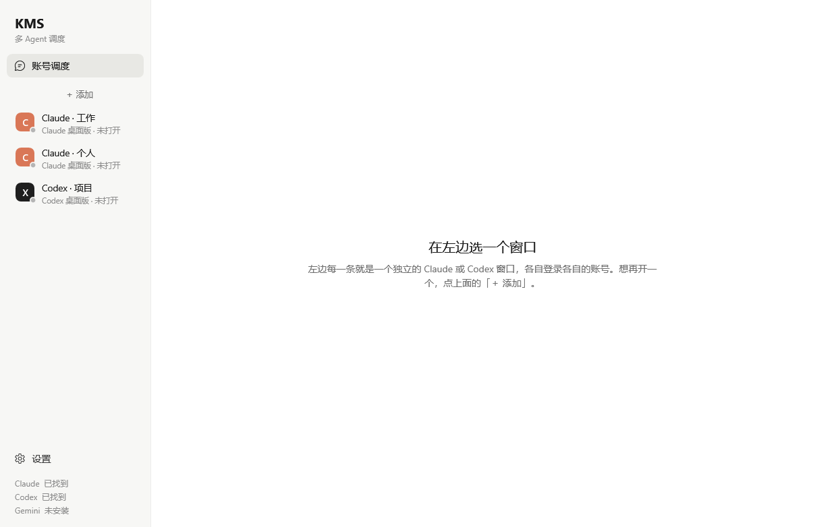

# KMS · Multi-Agent Dispatch

[简体中文](README.md) · [English](README.en.md)

Run multiple copies of desktop AI agents — **Claude**, **Codex**, **Gemini**, **DeepSeek**, **Grok**, and friends — side by side. Every window signs in with its own account, and you switch, arrange and sign in from one place.

A single ~450 KB Windows executable. Nothing to install, nothing downloaded at runtime, and it builds with the C# compiler that ships with Windows (.NET Framework 4.8).

> The current version only ships the “Account Dispatch” feature. Source for the earlier “Commander / CLI accounts / VMs” modules is still in the tree but no longer wired up; it will be removed in a later release.

## Supported desktop apps

| App | Status |
|---|---|
| Claude Desktop | ✅ Native support (multi-instance, embedding, in-window sign-in, sign out / switch account) |
| Codex Desktop | ✅ Native support (same, plus a per-window `CODEX_HOME`) |
| Gemini / DeepSeek / Grok Desktop | 🚧 The same approach applies, but the “recognise this app” layer (executable and package name) needs one mapping per app. Not done yet. |

> In other words: multi-instance launching, embedding, isolated sign-in and the in-window browser are generic; what is missing is a per-app identification entry. PRs welcome — or wait for “pick your own .exe” support.

## What problem it solves

The official desktop apps only accept one signed-in account at a time. Want to use a work account and a personal one together? You end up signing out and back in, and the sessions kick each other out.

KMS gives **every window its own config directory** (`--user-data-dir`, plus `CODEX_HOME` for Codex), so each window is an independent copy of the official app signed in as its own account. They run side by side without interfering.

## Features

- **Multi-instance**: `+ Add` opens another Claude / Codex window, each with its own data directory
- **Embedded in one UI**: click an entry in the sidebar and that window is docked into the pane on the right, kept aligned and full-size
- **In-window sign-in**: every window gets its own “vacuum browser” (Edge guest mode + a private profile). When the app tries to open a web page, KMS catches it and opens it inside the window; once the login callback arrives, the browser closes and the app comes back
- **Sign out / switch account**: the login data is renamed and kept aside (never deleted), then a fresh signed-out window opens
- **Rename, release to desktop, tile all, delete**
- **Read-only by design**: everything happens inside the official app's own window; KMS never stores or forwards passwords or tokens

## Screenshot



## Requirements

- Windows 10 1809+ / Windows 11
- .NET Framework 4.8 (ships with Windows, no SDK needed)
- Claude Desktop / Codex Desktop (MSIX builds)

## Build from source

```powershell
powershell -ExecutionPolicy Bypass -File build.ps1
```

The result is `AgentCommander.exe` in the repo root. To run the model-free self-test:

```powershell
.\AgentCommander.exe --selftest selftest.log
```

## How it works

1. **Multi-instance**: launch the official app with `--user-data-dir=<data\real-apps\<window id>>`; for Codex, point `CODEX_HOME` at `codex-home` inside that directory too.
2. **Embedding**: `SetParent` turns the app window into a child of a panel inside KMS, strips its caption/border, and keeps re-aligning it to the panel size.
3. **Keyboard**: a cross-process `SetFocus` silently fails, so KMS temporarily attaches the two threads' input queues with `AttachThreadInput`, sets focus, and follows up with `WM_ACTIVATE`.
4. **Login redirects**: it watches the browser processes the app spawns (`ProcWatch`), re-opens the requested URL in that window's own vacuum browser, and catches the `claude://` callback the browser produces so it reaches the right window.
5. **No lost windows**: embedded window handles are recorded in `data\embedded.txt`; on the next start, orphans left behind by a force-kill are restored to normal windows.

## Known limitations

- Embedding means “hosting someone else's window”, which is not officially supported: an app update may require an adjustment.
- The **X button only hides KMS to the tray**. Quit from the tray icon; don't force-kill it (a force-kill may leave orphaned windows — the next launch repairs them).
- Several windows editing the same files in the same project folder will overwrite each other.
- Whether stacking multiple subscription accounts violates any terms of service is your call.

## Disclaimer

This project only manages windows and forwards login flows. It does not modify or crack the official apps, and it never stores passwords or tokens. Check that your usage complies with the terms of service you are bound by.

## License

MIT
