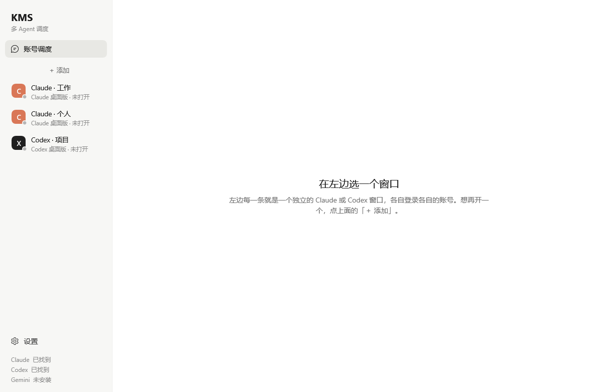

# KMS · 多 Agent 调度

把 **Claude 桌面版**、**Codex 桌面版** 同时开多份，每个窗口登录各自的账号，全部在一个窗口里切换、排列、登录。

一个约 450 KB 的单文件 Windows 程序，不安装、不联网下载任何东西，用系统自带的 .NET Framework 4.8 编译器就能从源码构建。

> 现在只保留「账号调度」这一套；早期版本里的「总指挥 / 命令行账号 / 虚拟机」相关模块源码还在（未接线），后续版本会清理。

## 它解决什么问题

官方桌面版一次只认一个登录。想同时用「工作号」和「个人号」，只能在同一个应用里反复退出、重新登录，还会互相顶掉。

KMS 的做法：**每个窗口给一份独立的配置目录**（`--user-data-dir`，Codex 另加 `CODEX_HOME`），于是每个窗口就是一份独立的官方应用，登录各自的账号。它们同时开着、同时干活，互不影响。

## 功能

- **多开**：`＋ 添加` 再开一个 Claude / Codex 窗口，每个窗口一份独立数据目录
- **嵌进同一个界面**：点左侧任意一条，该窗口就被嵌到右边那一格里，随窗口大小对齐、铺满
- **窗口内登录**：每个窗口配一个「真空浏览器」（Edge 访客模式 + 独立数据目录），应用要跳网页时被 KMS 接住，在窗口里打开；登录结果回传后自动关掉浏览器、切回应用
- **退出登录 / 换账号**：登录数据改名留档（不删除），重开一个未登录窗口
- **重命名、放回桌面、全部并排、删除**
- **只读/可改用**：所有动作都在官方应用自己的窗口里完成，KMS 不保存、不转发密码和登录令牌

## 截图



## 环境要求

- Windows 10 1809+ / Windows 11
- .NET Framework 4.8（Windows 自带，不需要装 SDK）
- Claude 桌面版 / Codex 桌面版（MSIX 安装版）

## 从源码构建

```powershell
powershell -ExecutionPolicy Bypass -File build.ps1
```

产物是根目录下的 `AgentCommander.exe`。想跑不调用模型的自检：

```powershell
.\AgentCommander.exe --selftest selftest.log
```

## 工作原理（简述）

1. **多开**：用 `--user-data-dir=<data\real-apps\窗口编号>` 启动官方应用；Codex 额外把 `CODEX_HOME` 指到该目录下的 `codex-home`。
2. **嵌入**：`SetParent` 把应用窗口变成 KMS 里一个面板的子窗口，去掉标题栏边框，并持续把它对齐到面板大小。
3. **键盘**：跨进程直接 `SetFocus` 不生效，所以用 `AttachThreadInput` 把两个线程的输入队列临时接起来再交焦点，并补一条 `WM_ACTIVATE`。
4. **登录跳转**：监视应用启动的浏览器进程（`ProcWatch`），把要打开的网址改成用这个窗口专用的真空浏览器打开；浏览器点登录链接时产生的 `claude://` 回传被接住，交给对应窗口。
5. **防止漏窗口**：正在嵌入的窗口句柄记在 `data\embedded.txt`，下次启动按清单把被强杀留下的“孤儿”窗口恢复成正常窗口。

## 已知限制

- 嵌入是“把别人的窗口塞进来”，不是官方支持的做法：应用更新后个别行为可能要跟着调。
- 点右上角 **X 只是收进托盘**；请从托盘退出，别用任务管理器强杀（强杀可能留下孤儿窗口，重启后会被自动修复）。
- 多个窗口在同一个项目文件夹里同时改同一批文件会互相覆盖。
- 用多个订阅账号叠加用量是否符合各家服务条款，需要你自己确认。

## 免责声明

本项目只做窗口管理和登录流程的转发，不修改、不破解官方应用，不保存任何密码或登录令牌。使用前请自行确认符合你所使用服务条款。

## License

MIT
